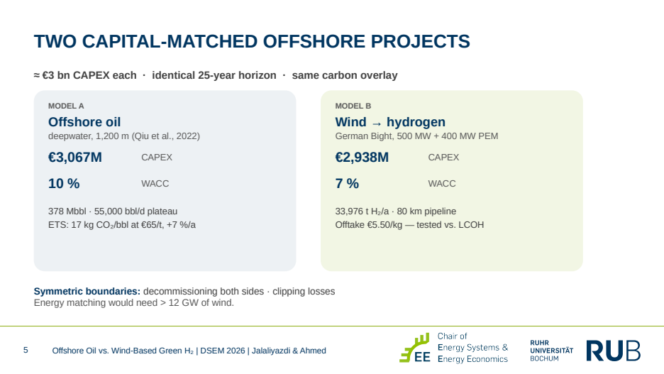
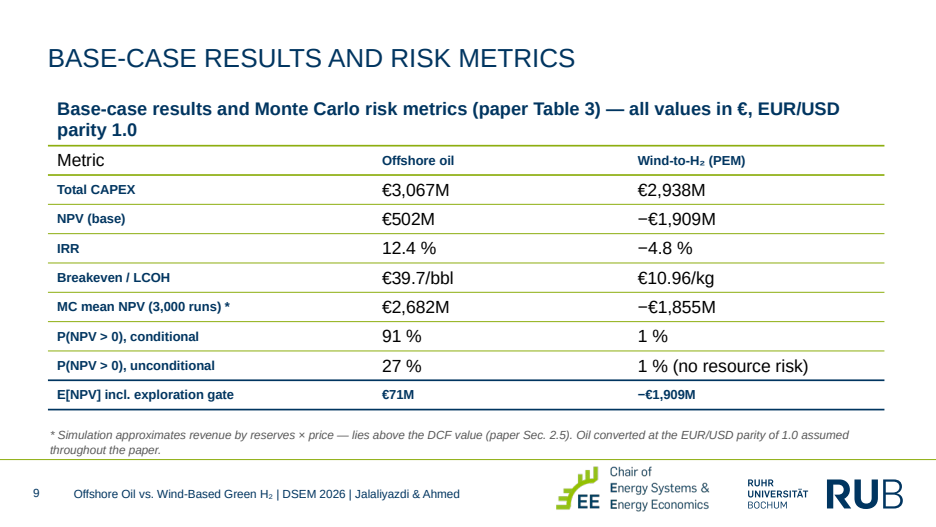
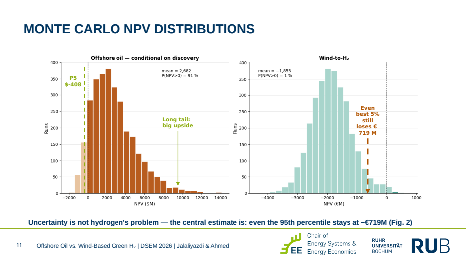
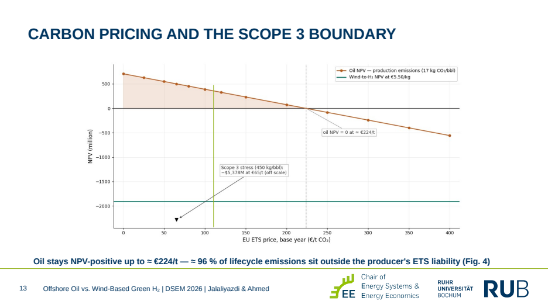
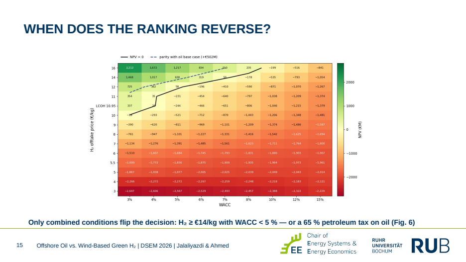

# Offshore Oil vs. Offshore Wind-Based Green Hydrogen

**Profitability under carbon pricing and exploration risk — a techno-economic comparison of two capital-matched offshore projects (≈ €3 billion each)**

Ruhr University Bochum · Chair of Energy Systems and Energy Economics · Demand and Supply in Energy Markets (DSEM) · Summer Term 2026

📄 **[Paper (PDF)](paper/Offshore_Oil_vs_Green_Hydrogen_Paper.pdf)** · 📊 **[Presentation (PDF, 19 slides)](presentation/Offshore_Oil_vs_Green_Hydrogen_Presentation.pdf)**

---

## Research question

> Accounting for exploration risk and cost uncertainty, how do offshore oil projects compare with offshore wind-based green hydrogen across carbon price scenarios — and why does capital still prefer oil?

## Approach

- **Two full project models, matched on invested capital** (≈ €3 bn, identical 25-year horizon): a deepwater oil archetype (1,200 m, 378 Mbbl, cost regressions of Qiu et al., 2022) and a **500 MW offshore wind farm feeding a 400 MW PEM electrolyser** in the German Bight (33,976 t H₂/year, 80 km pipeline).
- **Discounted cash flow** with technology-specific WACC (10 % oil, 7 % hydrogen), decommissioning on both sides and electrolyser clipping losses.
- **Monte Carlo simulation** with triangular distributions (7 oil and 9 hydrogen parameters) plus tornado sensitivities.
- **Carbon pricing at two system boundaries:** EU ETS on production emissions (€0–400/t) and an illustrative full-lifecycle **Scope 3** stress test (450 kg CO₂/bbl).
- **Exploration risk** as a Bernoulli gate (probability of success 30 %, sunk E&A €80M) — applied to oil only, because only oil carries resource risk.
- Built as a **fully formula-based Excel workbook — 13 sheets, 63,746 formulas**, every figure reproducible.

## Key results

| Metric | Offshore oil | Wind-to-H₂ (PEM) |
|---|---|---|
| Total CAPEX | €3,067M | €2,938M |
| NPV (base case) | **€502M** | **−€1,909M** |
| IRR | 12.4 % | −4.8 % |
| Breakeven / LCOH | €39.7/bbl | **€10.96/kg** (vs. €5.50/kg offtake) |
| P(NPV > 0), conditional | 91 % | 1 % |
| E[NPV] incl. exploration gate | €71M | −€1,909M |

**Uncertainty is not hydrogen's problem — the central estimate is.** Even the best 5 % of hydrogen runs still lose €719M.

## Carbon pricing and the Scope 3 boundary

Oil stays profitable up to **≈ €224/t CO₂** on production emissions. The system boundary, not the price, is decisive: about **96 % of oil's lifecycle emissions sit outside the producer's ETS liability**.

## When does the ranking reverse?

Only combined conditions flip the decision: hydrogen offtake near **€14/kg with WACC below ≈ 5 %**, or a North-Sea-style **65 % petroleum tax** on oil (oil NPV → −€1,444M).

## Conclusion

The investment preference for offshore oil is rational under current market design, resting on three pillars: externalised combustion emissions, cheap and diversifiable geological risk, and the absence of a cost-covering hydrogen offtake. Carbon pricing alone will not redirect this capital — the effective levers are long-term hydrogen offtake contracts, 3–5 % financing costs and fossil fiscal design.

## Tools and methods

Excel (DCF, Monte Carlo, scenario and sensitivity analysis) · LCOH · NPV / IRR · EU ETS carbon pricing · Scope 3 lifecycle emissions

---

**Naveed Ahmed** · M.Sc. student, Ruhr University Bochum · [LinkedIn](https://linkedin.com/in/naveedahmed7)

*Group paper, DSEM Summer Term 2026, supervised by Prof. Dr. Valentin Bertsch. Co-author as listed in the paper: Amirhossein Jalaliyazdi.*
